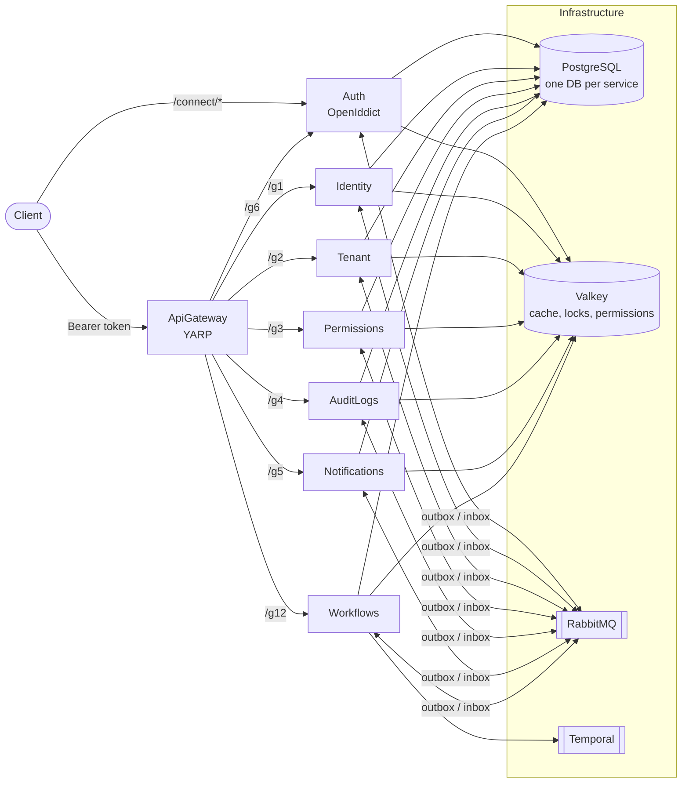

# TenantWright — .NET 10 Multi-Tenant SaaS Starter Template

A multi-tenant .NET 10 microservice template. It has an OAuth2/OIDC auth server, a YARP gateway, six domain services, transactional messaging with signed provenance, and opt-in per-tenant databases. It runs locally with one .NET Aspire command and deploys with Helm.

> **Status:** pre-1.0 template. Expect breaking changes.

## Highlights

- **Auth server** (`app/Auth`): OpenIddict OAuth2/OIDC with authorization code, refresh and client credentials. The password grant is available in Development only.
- **Gateway** (`gateway/ApiGateway`): YARP reverse proxy. It validates tokens before forwarding and applies rate limiting, request timeouts and security headers. It returns 404 for `/gN/internal/*` paths.
- **Services:** Identity, Tenant, Permissions, AuditLogs, Notifications and Workflows (Temporal). Each service owns its database and follows a strict layered project layout.
- **Fail-closed security:** cached permission evaluation backed by Valkey, tenant resolution that rejects ambiguous or mismatched input, and startup validation of security-critical settings.
- **Messaging:** you can choose Wolverine (MIT, the local default), MassTransit 9 (commercial licence) or None. Either broker provider uses a transactional outbox and an inbox, and every message carries an ECDSA P-256 origin attestation per service.
- **Multi-tenancy:** all tenants share a database by default. AuditLogs, Notifications and Permissions can opt into a dedicated database per tenant, with per-tenant migrations and fan-out of background work.
- **Audit logs:** captured through the messaging pipeline and sealed in a hash chain signed with HMAC-SHA256 keys.
- **Local dev with zero setup:** the Aspire AppHost starts PostgreSQL, Valkey, RabbitMQ and Temporal. It generates every local secret on first run.
- **Deployment:** Helm charts with digest-pinned images, environment overlays and preflight guardrails.

## Architecture

## Quick start

You need the .NET 10 SDK and Docker Desktop. See [Getting started](docs/getting-started.md) for details.

1. Trust the ASP.NET Core development certificate: `dotnet dev-certs https --trust`.
2. Start Docker Desktop.
3. `cd backend`
4. `dotnet build TenantWright.slnx`
5. `dotnet run --project orchestration/TenantWright.AppHost`
6. Open the Aspire dashboard URL printed in the console. The first run pulls container images, which takes several minutes.
7. Read the generated sign-in passwords: `dotnet user-secrets list --project orchestration/TenantWright.AppHost`.
8. Request a token and call the gateway. See [Getting started → Call the API](docs/getting-started.md#call-the-api).

## Services and local ports

| Resource | Project | HTTP / HTTPS | Gateway prefix |
|---|---|---|---|
| auth | `app/Auth/Auth` | 5234 / 7239 | `/g6` → `/api` |
| apigateway | `gateway/ApiGateway` | 5137 / 7030 | — |
| identity | `services/Identity/Identity` | 5161 / 7161 | `/g1` → `/api/identity` |
| tenant | `services/Tenant/Tenant` | 5162 / 7162 | `/g2` → `/api/tenant` |
| permissions | `services/Permissions/Permissions` | 5163 / 7163 | `/g3` → `/api/permissions` |
| auditlogs | `services/AuditLogs/AuditLogs` | 5164 / 7164 | `/g4` → `/api/audit-logs` |
| notifications | `services/Notifications/Notifications` | 5165 / 7165 | `/g5` → `/api/notifications` |
| workflows | `services/Workflows/Workflows` | 5166 / 7166 | `/g12` → `/api/workflows` |

Project paths are relative to `backend/`. Infrastructure containers use ports that Aspire allocates; the dashboard shows them.

## Documentation

- [Getting started](docs/getting-started.md): run locally, seeded users, tokens.
- [Architecture](docs/architecture.md): repository layout, services, shared libraries, request flow.
- [Configuration](docs/configuration.md): key settings, and running a single service.
- [Messaging](docs/messaging.md): providers, outbox/inbox, trust, adding contracts.
- [Multi-tenancy](docs/multi-tenancy.md): tenant resolution and dedicated tenant databases.
- [Security](docs/security.md): the security model in summary.
- [Deployment](docs/deployment.md): Helm charts, secrets, prerequisites.
- [Testing](docs/testing.md): test projects, and which suites need Docker or a licence.
- [Adding a service](docs/adding-a-service.md): a step-by-step checklist.
- [Troubleshooting](docs/troubleshooting.md)
- [Task records](docs/task/README.md): the planning convention that agent governance uses.

## Roadmap

This section shows where TenantWright is heading. Items are direction, not commitments, and the order can change. To propose an item or discuss one, open a [GitHub issue](https://github.com/yash9157/tenantwright/issues) or [discussion](https://github.com/yash9157/tenantwright/discussions).

Status legend:

- **Available:** in the code today.
- **Planned:** agreed direction, not started.
- **Exploring:** the design is still open.
- **Help wanted:** a good item to pick up.

### Available today

The [Highlights](#highlights) list above describes what ships today: Auth (OpenIddict), the YARP gateway, Identity, Tenant, Permissions, AuditLogs, Notifications and Workflows (Temporal). Messaging runs on Wolverine, MassTransit or None, with a signed outbox and inbox ([Messaging](docs/messaging.md)). Tenants use a shared database or a dedicated one ([Multi-tenancy](docs/multi-tenancy.md)). The stack runs locally with the Aspire AppHost ([Getting started](docs/getting-started.md)) and deploys with Helm ([Deployment](docs/deployment.md)).

### Design rules for new modules

- Use the same six-project service shape as the other services ([Adding a service](docs/adding-a-service.md)).
- Keep every action tenant-isolated and fail-closed.
- Publish events as `*Eto` contracts in `Shared.EventContracts`, sent through the outbox.
- Define permissions in the service's `*Permissions` class in its `Domain.Shared` project.
- Put external providers behind a neutral interface, the way messaging does ([Adding another provider](docs/messaging.md#adding-another-provider)).
- Make each provider optional and off by default.
- Never put secrets in `appsettings.json`.

### New modules

| Module | What it does | Status |
|---|---|---|
| Billing & Subscriptions | Plans, trials, seats, usage metering, invoices, proration, dunning, tax hooks | Planned |
| Payments | Provider-neutral payment intents, refunds, payment methods, webhook signature checks, idempotency, reconciliation | Planned |
| Files & Storage | A file service on `Shared.BlobStoring`, with a virus-scan hook and per-tenant quotas. Amazon S3, Azure Blob and file-system providers are available in `Shared.BlobStoring`; MinIO and Google Cloud Storage are planned | Planned |
| Outbound webhooks | Tenant webhook subscriptions, signed deliveries, retries, a delivery log | Planned, Help wanted |
| API keys & developer portal | Per-tenant API keys with scopes, rotation and a portal to manage them | Planned |
| Tenant settings & branding | Custom domains, themes, white-label emails | Planned |
| Localization | Translated messages, emails and templates per tenant and user | Planned, Help wanted |
| Search | Tenant-scoped search behind an adapter for OpenSearch or Meilisearch | Exploring |
| Reporting & exports | Scheduled reports and data exports per tenant | Exploring |
| Data privacy | Tenant data export, right to erasure, retention policies across services | Planned |
| Feature flags & plan entitlements | Link the existing Permissions feature catalog to billing plans | Planned |
| Integrations hub | Slack, Microsoft Teams and Zapier-style connectors | Exploring, Help wanted |
| Scheduler and jobs UI | View and manage background jobs across services | Exploring |
| AI module (optional) | An LLM gateway with per-tenant keys, usage limits and prompt audit | Exploring |

### Payment gateways

Every gateway plugs into one `IPaymentProvider`-style abstraction in the Payments module. None is available yet.

| Provider | Regions | Notes | Status |
|---|---|---|---|
| Stripe | Global | Hosted Checkout and Elements, subscriptions | Planned |
| Razorpay | India | Cards, UPI, netbanking, subscriptions | Planned |
| PayPal / Braintree | Global | Wallet checkout and cards | Planned |
| Adyen | Global | Enterprise card acquiring | Exploring |
| Cashfree | India | Payments and payouts | Exploring, Help wanted |
| PhonePe / UPI | India | UPI intent and collect flows | Exploring, Help wanted |
| Paytm | India | Wallet and UPI | Exploring, Help wanted |
| Mollie | Europe | Local European payment methods | Exploring, Help wanted |
| Square | US, CA, UK, AU, JP | Online and in-person payments | Exploring |
| Paddle | Global | Merchant of record, handles sales tax | Exploring |
| Lemon Squeezy | Global | Merchant of record for software sales | Exploring |
| Checkout.com | Global | Enterprise card acquiring | Exploring |

Every provider must meet these rules:

- Verify the signature of every incoming webhook.
- Use idempotency keys for every write to the provider.
- Publish outcomes as outbox events, such as `PaymentSucceededEto`.
- Keep PCI scope at the provider: hosted checkout or elements only, and no card data stored.
- Support a sandbox mode for the local AppHost.

### Notification providers

| Channel | Provider | Status |
|---|---|---|
| Email | SMTP (MailKit) | Available |
| SMS | Twilio | Available |
| WhatsApp | Meta WhatsApp Cloud API | Available |
| Push | Firebase Cloud Messaging, Apple Push Notification service, Web Push | Available |
| Email | SendGrid, Amazon SES, Mailgun, Postmark | Planned, Help wanted |
| SMS | MSG91, Vonage | Planned, Help wanted |

### Messaging and platform

| Item | Status |
|---|---|
| Signed dead-letter replay for Wolverine (MassTransit already has protected replay) | Planned |
| More transports behind `Messaging:Provider`: Azure Service Bus, Amazon SQS/SNS, Kafka | Exploring, Help wanted |
| Audit log archive for dedicated AuditLogs databases (archive runs on the shared database today; legal hold is available) | Planned |
| Schema-per-tenant option, next to shared and dedicated databases | Exploring |
| Move a tenant between shared and dedicated databases, with data migration tooling | Planned |
| Multi-region deployment | Exploring |
| Per-plan rate limits (the gateway has global rate limiting today) | Planned |

### Security and identity

Passkeys, MFA, trusted devices and sessions are available in Identity.

| Item | Status |
|---|---|
| Per-tenant SSO with SAML 2.0 and enterprise OIDC | Planned |
| SCIM user and group provisioning | Planned |
| Social login (Google, Microsoft, GitHub and others) | Planned, Help wanted |
| OAuth 2.0 Token Exchange (RFC 8693) for service-to-service user delegation. This is a security-sensitive change and needs a separate design review | Exploring |

### NuGet packages and templates

The plan is to publish the infrastructure libraries on nuget.org, so other apps can use them without the whole template.

| Package | From project | Status |
|---|---|---|
| `TenantWright.MultiTenancy` | `Shared.MultiTenancy` | Planned |
| `TenantWright.EventBus` | `Shared.EventBus` | Planned |
| `TenantWright.EventBus.Wolverine` | `Shared.EventBus.Wolverine` | Planned |
| `TenantWright.EventBus.MassTransit` | `Shared.EventBus.MassTransit` | Planned |
| `TenantWright.EventBus.Hosting` | `Shared.EventBus.Hosting` | Planned |
| `TenantWright.EntityFrameworkCore` | `Shared.EntityFrameworkCore` (outbox, inbox, tenant databases) | Planned |
| `TenantWright.Permissions` | `Shared.Permissions`, `Shared.Permissions.Abstractions` | Planned |
| `TenantWright.Uow` | `Shared.Uow` | Planned |
| `TenantWright.Caching` | `Shared.Caching` | Planned |
| `TenantWright.DistributedLocking` | `Shared.DistributedLocking` | Planned |
| `TenantWright.AuditLogs` | `Shared.AuditLogs` | Planned |
| `TenantWright.BackgroundTasks` | `Shared.BackgroundTasks`, `Shared.BackgroundTasks.Hangfire` | Planned |
| `TenantWright.BlobStoring` | `Shared.BlobStoring` | Planned |
| `TenantWright.Templates` | `dotnet new` templates (below) | Planned |

The template package adds two commands:

- `dotnet new tenantwright` creates the whole solution, with options such as `--messaging wolverine|masstransit|none` and `--no-temporal`.
- `dotnet new tenantwright-service` adds one six-project service, wired into the AppHost, the gateway and the Helm charts.

Release rules for the packages: Semantic Versioning, a CHANGELOG, Source Link, deterministic builds, symbol packages, and signed packages published from CI with trusted publishing.

Open design decision: the projects and namespaces stay `Shared.*` until the package rename is designed. Whether namespaces become `TenantWright.*`, and how package boundaries map to projects, is not decided yet.

### Frontend and SDKs

| Item | Status |
|---|---|
| React admin app (super-admin and tenant-admin) | Planned |
| Angular admin app (super-admin and tenant-admin) | Planned |
| TypeScript and C# API clients generated from OpenAPI | Planned, Help wanted |

### Developer experience and project health

| Item | Status |
|---|---|
| GitHub Actions CI: build, tests, Helm lint | Planned, Help wanted |
| Dev Container and GitHub Codespaces setup | Planned, Help wanted |
| Sample business service (Orders) as a reference | Planned |
| Documentation site | Exploring |
| `CONTRIBUTING.md`, issue and pull request templates | Planned, Help wanted |
| `CHANGELOG.md` | Planned |

### How to help

1. Pick an item marked **Help wanted**.
2. Open an issue before large work, so the design can be agreed first.
3. Follow [AGENTS.md](AGENTS.md) and [Adding a service](docs/adding-a-service.md).

## Security

Report vulnerabilities privately; see [SECURITY.md](SECURITY.md).

## License

Licensed under the [Apache License 2.0](LICENSE). Redistributions and derivative works must keep the attribution notices in [NOTICE](NOTICE), as section 4(d) of the license requires.

Third-party components keep their own licences. The optional MassTransit provider uses MassTransit 9, which is commercially licensed and needs a licence to run. The default Wolverine provider is MIT-licensed.
