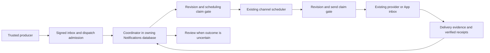

# Architecture

## Repository layout

```text
./
├── README.md, LICENSE, NOTICE
├── docs/                         # this documentation
└── backend/                     # backend (.NET 10)
    ├── TenantWright.slnx             # solution (source of truth for the project list)
    ├── app/Auth/                 # OAuth2/OIDC server (Auth, Auth.Domain.Shared)
    ├── gateway/ApiGateway/       # YARP gateway
    ├── services/                 # Identity, Tenant, Permissions, AuditLogs, Notifications, Workflows
    ├── shared/Shared.*/          # infrastructure-only libraries
    ├── orchestration/            # TenantWright.AppHost (Aspire) and TenantWright.ServiceDefaults
    ├── tests/                    # 27 xUnit test projects
    ├── charts/                   # Helm charts, installers, environment overlays
    ├── scripts/                  # verification and maintenance scripts
    └── tools/                    # repository indexer tooling, deployment helpers
```

## Components

| Component | Responsibility |
|---|---|
| **Auth** (`app/Auth/Auth`) | OpenIddict server with `/connect/authorize`, `/connect/token`, `/connect/logout` and `/connect/userinfo`. Supports authorization code, refresh and client credentials; the password grant works in Development only. Also issues internal M2M tokens, runs OpenIddict client/scope management, and handles optional self-service tenant registration |
| **ApiGateway** (`gateway/ApiGateway`) | The only public entry point. Routes `/gN/*` prefixes to services. Validates tokens for the audiences of every service and applies rate limiting, timeouts, body/header limits and security headers. Strips `X-Tenant-Id` and internal headers, and returns 404 for `/gN/internal/*` and `/gN/integration-api/*` |
| **Identity** | Users, roles, sessions, MFA/passkeys, trusted devices, invitations, security logs and login risk. Also serves internal user lookups for Auth |
| **Tenant** | Tenant lifecycle, current-tenant profile, ownership, and dedicated-database assignment |
| **Permissions** | Aggregates the permission and feature catalog. Handles grants, approvals, conflict rules, evaluation, snapshots, access reviews and delegation. Publishes cache updates that every service consumes |
| **AuditLogs** | Audit ingestion (an audit-write command), query, hash-chain sealing and archive. Uses Hangfire for scheduled jobs |
| **Notifications** | Delivery, provider configuration (protected secrets), a SignalR hub (`/g5/hubs/notifications`) and anonymous provider webhooks (`/g5/webhooks/*`) |
| **Workflows** | Temporal client and worker host. Its registered workflow is `tenant-initial-owner-onboarding-v1` (`InitialOwnerOnboardingWorkflow`) |

Gateway routes come from [`gateway/ApiGateway/appsettings.json`](../backend/gateway/ApiGateway/appsettings.json): `g1` identity, `g2` tenant, `g3` permissions, `g4` auditlogs, `g5` notifications, `g6` auth and `g12` workflows. Numbers `g7`–`g11` are unused.

## Service layout

Each service family uses six projects. Here they are for AuditLogs:

| Project | Holds |
|---|---|
| `AuditLogs` (host) | `Program.cs` and the host module: thin controllers, authentication, middleware, workers |
| `AuditLogs.Application` | Use cases, app services, message handlers |
| `AuditLogs.Application.Contracts` | Public app-service interfaces and DTOs |
| `AuditLogs.Domain` | Entities and invariants |
| `AuditLogs.Domain.Shared` | Error codes, permission names and definitions, shared enums |
| `AuditLogs.EntityFrameworkCore` | DbContext, mappings, migrations, design-time factory |

`TenantWright.slnx` lists only four Workflows projects: host, Application, Application.Contracts and EntityFrameworkCore. Its `Workflows.Domain` and `Workflows.Domain.Shared` folders contain no projects.

A service never references another service's implementation projects. Cross-service types travel through `Shared.EventContracts` or `*.Domain.Shared` contract assemblies. For example, `Permissions.Application` references every service's `*.Domain.Shared` so it can aggregate their permission definitions.

## Shared libraries

All shared libraries live under `shared/`. They are infrastructure only and hold no product behaviour.

| Library | Purpose |
|---|---|
| `Shared.Modularity` | Module system (`BaseModule`, `[DependsOn]`) and convention DI (`ITransientDependency`, `[ExposeServices]`) |
| `Shared.Autofac` | Autofac container integration (`UseSharedAutofac`) |
| `Shared.AspNetCore.Host` | Host module and middleware, including multi-tenancy and session validation |
| `Shared.AspNetCore.ProblemDetails` | Problem-details error responses |
| `Shared.Domain`, `Shared.Domain.Shared` | Entity base types, `IMultiTenant`, event attributes |
| `Shared.Data` | Connection-string catalog and resolution options, data seeding, filters |
| `Shared.EntityFrameworkCore` | `SharedDbContext`, tenant query filters, auto-migration, the tenant connection-string resolver, tenant database migration and fan-out, outbox/inbox persistence |
| `Shared.Uow` | Unit of work |
| `Shared.MultiTenancy` | Current tenant and tenant resolution |
| `Shared.Security`, `Shared.CurrentUser` | Claim types and parsing; current-user access |
| `Shared.Permissions`, `Shared.Permissions.Abstractions` | Permission policies, the Valkey-backed checker, definition abstractions |
| `Shared.Caching` | Valkey/HybridCache configuration |
| `Shared.DistributedLocking` | Distributed locks (DistributedLock.Redis against Valkey) |
| `Shared.BackgroundTasks`, `Shared.BackgroundTasks.Hangfire` | Periodic workers and background jobs; Hangfire on PostgreSQL |
| `Shared.BlobStoring` | Blob storage abstraction with S3 and Azure providers |
| `Shared.AuditLogs` | Audit capture, signing and publishing |
| `Shared.EventContracts` | Message contracts and their JSON source-generation context |
| `Shared.EventBus`, `.Hosting`, `.MassTransit`, `.Wolverine` | Provider-neutral messaging core, provider selection, and the two provider implementations |

`orchestration/TenantWright.ServiceDefaults` adds health checks and OpenTelemetry. The OTLP exporter switches on when `OTEL_EXPORTER_OTLP_ENDPOINT` is set. Services log to the console through Serilog.

## Request flow

1. The client gets a token from Auth. Each scope maps to the resource audiences its target service validates; for example, scope `identity` maps to resources `IdentityService` and `identity`.
2. The gateway validates the token against the issuer and the audiences in `AuthServer:Audiences`, strips untrusted headers, and forwards the request.
3. The target service validates the token with OpenIddict validation, for its own audience only.
4. In the service pipeline (see `AuditLogsHostModule.OnApplicationInitializationAsync`), the order is: unit of work, audit capture, authentication, session validation, tenant resolution, authorization, then the controller.
5. Permission policies are evaluated by `ValkeyPermissionChecker`. It reads cached grants keyed by tenant, user and role identity.

Service-to-service HTTP calls use client-credentials tokens (for example, `auth-internal` with internal scopes). They reach internal endpoints under `api/<service>/internal/*`, which the gateway never exposes.

## Asynchronous work

- **Messaging.** Commands and events go through a transactional outbox and are consumed through an inbox. See [Messaging](messaging.md).
- **Workers.** Periodic workers (`AddSharedPeriodicWorker`) hold a distributed-lock lease, so only one replica runs each worker. Workers that touch tenant-dedicatable data iterate every database through `TenantDatabaseFanOut`; see [Multi-tenancy](multi-tenancy.md).
- **Workflows.** Temporal is used by Workflows. Its worker only polls when `Temporal:Enabled` and `Temporal:WorkerEnabled` are both true.

## Notification dispatches

Notifications owns explicit parallel and ordered fallback plans. A signed request
is admitted in the inbox transaction as `NotificationDispatch`, keyed recipients,
ordered channel steps and revisioned routing history. Each step has one stable
child request ID. Existing `Notification` and delivery rows own actual sends.
No workflow service or additional message transport coordinates routing.



Fallback advances independently per recipient after definitive rejection or a
permitted channel exclusion. Acceptance holds routing without asserting delivery;
quiet hours and digest policies defer it. Unknown sends require review. A later
verified failure after acceptance can resume fallback before expiry; contradictory
evidence after confirmed delivery requires review.

Scheduling, send claims, cancellation and recovery fence the same dispatch
revision. Preparation and provider I/O run outside these transactions. Preparation
claims last 60 seconds, preparation/provider waits are bounded to 30 seconds, and
both coordinator and send batches stop admitting further work after 30 seconds.
The existing worker and tenant database fan-out own execution. Readiness reports
failed reconciliation or more than five minutes without a successful cycle.

Shared digests link their emitted child in the child's transaction. A digest with
stopped and active source intents, or more than 1000 sources, requires review.
It cannot send cancelled content or silently bypass digest policy. Existing live
WhatsApp consent restrictions and disabled group-audience expansion remain in force.

Completed dispatch history is archived in bounded batches to
`ArchivedNotificationDispatches`. Recipient keys, content, destinations and actor
identities are withheld from that archive; channel archives retain their existing
ownership. Dispatches with unresolved/review work and held digests are protected.
