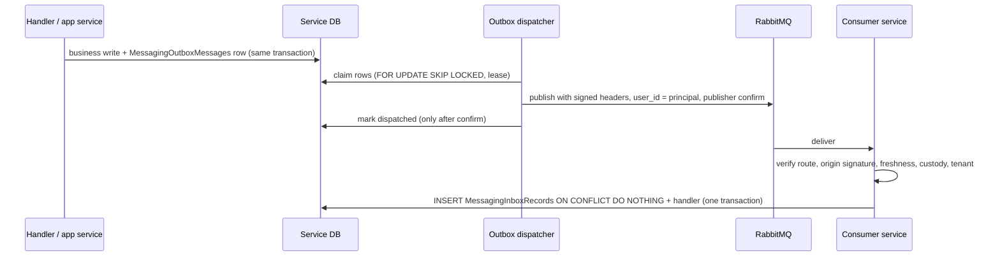

# Messaging

Services exchange commands and events over RabbitMQ. A provider-neutral core in `shared/Shared.EventBus` and `shared/Shared.EntityFrameworkCore/Messaging` handles contracts, topology, the outbox and inbox, trust and tenancy. A pluggable provider supplies the broker transport.

## Providers

Every workload selects one provider with `Messaging:Provider`. Values are matched case-insensitively. An unknown value fails startup.

| Value | Transport | Licence | Notes |
|---|---|---|---|
| `Wolverine` | WolverineFx 6.51.0 + RabbitMQ.Client | MIT | Default for local AppHost runs. Consume-only: the neutral outbox owns durability |
| `MassTransit` | MassTransit 9.2.0 | Commercial | Needs exactly one of `MT_LICENSE` (inline) or `MT_LICENSE_PATH` (absolute path to a read-only file). Locally, set the AppHost setting `LocalMessaging:MassTransitLicensePath`. In Kubernetes, use the `tenantwright-masstransit-license` Secret, which is mounted as `MT_LICENSE` |
| `None` | none | — | Bus-free. Default in `appsettings.json` and in the Helm installers |

Versions are pinned in [`Directory.Build.props`](../backend/Directory.Build.props). The licence handling is in `shared/Shared.EventBus.MassTransit/MassTransitLicenseResolver.cs`. Check the vendors' current licence terms yourself; this repository states them only in code comments and in [NOTICE](../NOTICE).

### Behaviour with `None`

([`NullTenantWrightMessageSender`](../backend/shared/Shared.EventBus/Messaging/NullTenantWrightMessageSender.cs), `SharedAuditLogsModule`)

- **Events** are dropped. Each drop increments the `tenantwright.messaging.event.dropped` metric.
- **Commands** fail closed: `SendCommandAsync` throws, because no consumer would ever process them.
- **Audit records** are written to the structured log (`SimpleLogAuditingStore`, `LogOnlyAuditLogWriteRequestPublisher`) instead of being sent to AuditLogs.
- **Nothing else is registered:** no transport, outbox dispatcher, consumers or options validation. The topology still checks that the service's principal is approved.

Features that need messaging stop working under `None`. Two examples are tenant onboarding through Workflows and the dedicated-database migration triggers.

## Configuration

`Messaging:*` ([`MessagingOptions`](../backend/shared/Shared.EventBus/Messaging/MessagingOptions.cs)) is validated at startup by `MessagingOptionsValidator` whenever the provider is not `None`.

- **`ServiceName`, `ProducerPrincipal`:** both must equal the service principal (`tenantwright-<service>`).
- **`RabbitMq`:**
  - Connection: `HostName`, `Port` (5671), `VirtualHost` (must not be `/`), `UserName` (must equal the principal, never `guest`), `Password`.
  - TLS: `UseTls` (true), `TrustedCaCertificatePath`, plus `ClientCertificatePath` and `ClientPrivateKeyPath` (both required when TLS is on).
  - `AllowInsecureTransport`: accepted only in Development or Test environments.
  - Throughput: `PrefetchCount`, `ConcurrentMessageLimit`.
  - `PublisherConfirmation` and `DetectUnroutableMessages` must stay `true`.
- **`Trust`:**
  - `ActiveKeyId` and `PrivateKeyPath` (absolute, read-only PEM).
  - `PublicKeys[n]`: `KeyId`, `Actor`, `PublicKeyPath`, `Revoked`.
  - Freshness bounds: `MaximumOriginAge`, `MaximumFutureClockSkew`, `MaximumRelayLifetime`.
- **`Delivery`:** `ImmediateRetryMilliseconds` and `DelayedRedeliverySeconds`, both fixed schedules, plus `StopTimeout`.
- **`Replay`:** the replay actor `tenantwright-messaging-replay` and its lifetimes.
- **`Outbox`, `Inbox`:** polling, batch, lease, retry and retention settings (`TenantWrightMessagingPersistenceOptions.cs`).

The AppHost generates all of this for local runs. See [Getting started](getting-started.md#choosing-the-local-messaging-provider).

## Delivery pipeline



- **Outbox** (`MessagingOutboxMessages`): `ITenantWrightMessageSender` writes the message in the caller's unit of work. `TenantWrightOutboxDispatcher` dispatches it at least once and is safe to run on several replicas. Failures retry with exponential backoff and jitter. A message that exceeds `MaxAttempts`, or whose origin would be stale at the consumer, is parked. The dispatcher runs over the shared database and every dedicated tenant database.
- **Inbox** (`MessagingInboxRecords`, key `(MessageId, Endpoint)`): deduplication is per message and endpoint. A duplicate is acknowledged without running the handler. If the handler fails, the inbox row rolls back with it. Retention keeps records for at least as long as the verifier would still accept the message.
- **Tables:** both tables, plus `MessagingReplayState`, are added to a DbContext by `modelBuilder.AddTenantWrightMessagingEntities()` ([`TenantWrightMessagingModelBuilderExtensions`](../backend/shared/Shared.EntityFrameworkCore/Messaging/TenantWrightMessagingModelBuilderExtensions.cs)).

### Failure handling

A handler signals "valid message, retry later" by throwing an exception that implements [`ITenantWrightTransientMessageFailure`](../backend/shared/Shared.EventBus/Messaging/TenantWrightTransientMessageFailure.cs). Mark only failures that clear without an operator, such as a tenant cache that has not converged or a lock another replica holds. `TenantWrightMessageFailureClassifier` also finds the marker inside wrapping and aggregate exceptions. Security failures and cancellations are never transient.

| Failure | Wolverine | MassTransit |
|---|---|---|
| `MessagingSecurityException` | Error queue at once | Error queue at once (never retried or redelivered) |
| Marked transient | Retried in process after 1, 5, 15, 30 and 60 s (about 2 minutes), then the error queue | Immediate retries (250 and 1000 ms), then delayed redelivery after 30, 120 and 600 s, then the error queue |
| Anything else | Immediate retries (250 and 1000 ms), then the error queue | Same as marked transient |

The Wolverine provider keeps no message store, and RabbitMQ has no native scheduling there, so `ScheduleRetry` has nowhere to keep a retry. Its transient cooldowns therefore run inline. The delivery stays unacknowledged and occupies one of the endpoint's `ConcurrentMessageLimit` consumer slots for at most the sum of the cooldowns. The endpoint's other slots and every other endpoint keep consuming, and a host shutdown leaves the delivery to the broker.

## Trust model

Code lives in `MessagingTrust.cs`, `MessagingAttestations.cs` and `TenantWrightInboundTrustVerifier.cs` under `shared/Shared.EventBus/Messaging/`.

- **Origin attestation.** Each principal signs every message with its own ECDSA P-256 key. The signature covers the message id, contract identity, producer, scope, tenant id, issue time, a canonical payload SHA-256 and the key id. It travels in the `x-tenantwright-*` headers. Consumers verify the signature against `Trust:PublicKeys`. A key marked `Revoked: true` is rejected.
- **Route authorization.** The producer must appear in the contract route's allowed origin principals. The receiving endpoint must list the contract.
- **Broker user-id binding.** Publishers set the RabbitMQ `user_id` property to their principal, and the broker validates it against the authenticated user. For direct delivery, the broker-authenticated actor must equal the signed producer.
- **Tenant restoration.** A contract is either `HostOnly` or `TenantRequired`. The signed scope and tenant must match the contract and the message body. The handler then runs inside `CurrentTenant.Change(tenantId)`.
- **Failures.** Verification failures throw `MessagingSecurityException` and are never retried as transient errors.

### MassTransit-only custody features

Wolverine registers no redelivery or replay custody verifier, so redelivered and replayed custody shapes are always rejected. Under Wolverine:

- A `MessagingSecurityException` goes straight to the error queue.
- Marked transient failures get the longer in-process cooldowns, and other failures the immediate-retry cooldowns, then go to the error queue (see [Failure handling](#failure-handling)).
- Quorum queues use native per-queue dead-lettering.

- **Delayed redelivery custody.** Queue-based delayed redelivery uses the fixed `DelayedRedeliverySeconds` schedule. The endpoint owner re-sends the message with a signed relay attestation, which is checked against RabbitMQ `x-death` history.
- **Signed terminal custody.** Messages moved to error or dead-letter queues carry a signed terminal attestation covering the raw body and the origin and relay chains.
- **Protected replay.** `ProtectedReplayService` re-verifies a terminal message, authorizes and audits the replay, and issues a single-use replay id stored in `MessagingReplayState`. It then re-sends as `tenantwright-messaging-replay`. Consumers accept each replay id only once.

## Topology

[`TenantWrightMessagingTopology`](../backend/shared/Shared.EventBus/Messaging/TenantWrightMessagingTopology.cs) is the single, static source of truth. It defines:

- **Principals:** the `*Principal` constants (`tenantwright-auditlogs`, `tenantwright-auth`, `tenantwright-identity`, `tenantwright-notifications`, `tenantwright-permissions`, `tenantwright-tenant`, `tenantwright-workflows`).
- **Routes:** `Event<T>(producers...)` for fan-out events and `Command<T>(destinationQueue, producers...)` for point-to-point commands.
- **Endpoints:** `Endpoint(name, ownerPrincipal, contractTypes...)` declarations. Endpoint names follow `tenantwright-<owner>-<purpose>-v1`. Every principal also gets a `<principal>-permission-cache-v1` endpoint.

Each host binds to its principal:

```csharp
services.AddTenantWrightMessagingHost<AuditLogsDbContextApp>(configuration, TenantWrightMessagingTopology.AuditLogsPrincipal);
```

## Adding a message contract and handler

This walk-through follows an existing event, `TenantOwnershipInvitationRequestedEto`, which Tenant publishes and Identity consumes.

1. **Define the contract** in `shared/Shared.EventContracts`, for example in `TenantContracts.cs`. Types ending in `Eto` may only live in approved locations; `scripts/verify-eto-placement.ps1` checks this.

   ```csharp
   [EventName("Shared.EventContracts.TenantOwnershipInvitationRequestedEto")]
   [DistributedContract(1, DistributedContractScope.HostOnly, DistributedContractDataClassification.Sensitive)]
   public sealed class TenantOwnershipInvitationRequestedEto { /* ... */ }
   ```

   - Both attributes are in the `Shared.Events` namespace (`shared/Shared.Domain.Shared/Events/`).
   - A `TenantRequired` contract must implement `IMultiTenant`.
2. **Register it for JSON source generation.** Add `[JsonSerializable(typeof(TenantOwnershipInvitationRequestedEto))]` to [`TenantWrightContractJsonContext`](../backend/shared/Shared.EventContracts/TenantWrightContractJsonContext.cs). Serializing an unregistered type throws.
3. **Route it.** In `TenantWrightMessagingTopology`:
   - add `Event<TenantOwnershipInvitationRequestedEto>(TenantPrincipal)` (or a `Command<T>`) to `Routes`;
   - add or extend an endpoint in `CreateEndpoints()`, for example `Endpoint("tenantwright-identity-ownership-invitation-v1", IdentityPrincipal, typeof(TenantOwnershipInvitationRequestedEto), ...)`.
4. **Handle it** in the consuming service's Application project:

   ```csharp
   [ExposeServices(typeof(ITenantWrightMessageHandler<TenantOwnershipInvitationRequestedEto>), IncludeSelf = true)]
   public sealed class TenantOwnershipInvitationRequestedEventHandler
       : ITenantWrightMessageHandler<TenantOwnershipInvitationRequestedEto>, ITransientDependency
   {
       public Task HandleAsync(TenantOwnershipInvitationRequestedEto message, CancellationToken cancellationToken) { /* ... */ }
   }
   ```

   The handler runs after trust verification and tenant restoration, inside the inbox transaction. Messages it sends go to the outbox in the same transaction. The reference implementation is `services/Identity/Identity.Application/Invitations/TenantOwnershipInvitationRequestedEventHandler.cs`.
5. **Publish it** with `ITenantWrightMessageSender.PublishEventAsync(...)`, or `SendCommandAsync(...)` for a command, inside a unit of work.
6. **Run the contract and topology tests:** `tests/Shared.EventContracts.Tests` and `tests/Shared.EventBus.Tests`. Then check broker permissions for any new queue. Local permissions are generated by [`LocalBrokerDefinitions.cs`](../backend/orchestration/TenantWright.AppHost/LocalBrokerDefinitions.cs). Cluster permissions live in `charts/tenantwright-rabbitmq/values.yaml`; verify them with `scripts/verify-messaging-charts.ps1`.

## Adding another provider

1. **Create a project** such as `shared/Shared.EventBus.<Name>`, with a class that implements [`ITenantWrightMessagingProvider`](../backend/shared/Shared.EventBus/Messaging/ITenantWrightMessagingProvider.cs): `Kind` plus `Register(IServiceCollection, IConfiguration, TenantWrightMessageCatalog)`.
2. **Register only what is provider-specific:**
   - An `ITenantWrightMessagingTransport`. It must complete only after the broker confirms routing, and must forward `MessageId` and all headers unchanged.
   - Consumers for `catalog.ReceiveEndpoints`. Each must build a `TenantWrightInboundMessage` and call `TenantWrightInboundMessagePipeline.ProcessAsync<T>`.
   - Optionally, the custody and replay verifiers.
   - A health check.
   - Never re-register neutral services.
3. **Make it selectable.** Add a value to the `TenantWrightMessagingProvider` enum. Add an instance to `TenantWrightMessagingProviders.Installed` in [`shared/Shared.EventBus.Hosting/TenantWrightMessagingProviders.cs`](../backend/shared/Shared.EventBus.Hosting/TenantWrightMessagingProviders.cs), and reference the project from `Shared.EventBus.Hosting`.
4. **Wire the tooling.** Allow the value in `LocalMessaging.ReadProvider` (AppHost) and in the `-MessagingProvider` sets of `charts/helm-install-all.ps1` and `charts/apply-secrets.ps1`. Then add provider tests modelled on `tests/Shared.EventBus.Wolverine.Tests`.
