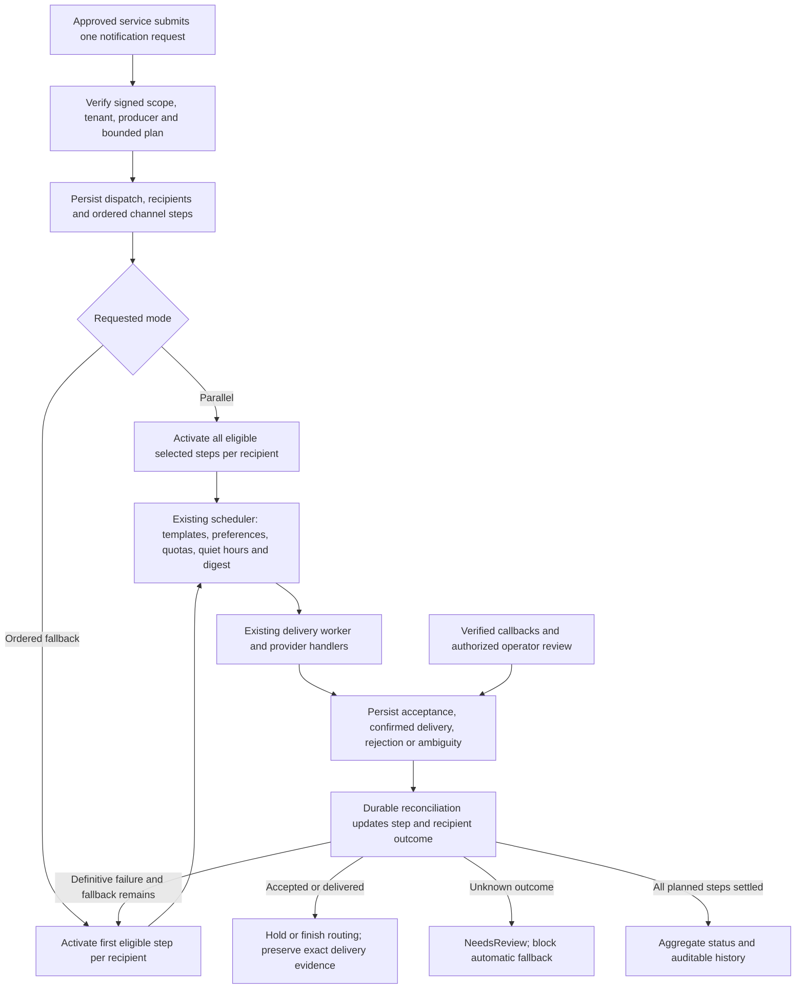
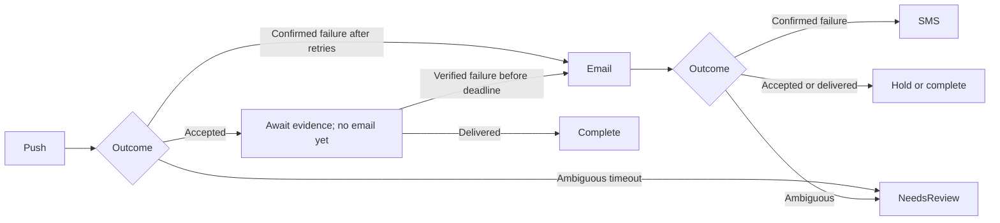

# Omnichannel notification orchestration

Status: Implemented and verified locally. Persistent rollout remains separate.

The user approved parallel and ordered fallback, definitive-failure-only automatic
fallback, all five existing channels and backend query, cancel and recovery.
Disposable PostgreSQL and Valkey tests were approved. Baseline Notifications
tests passed 233 of 233 before implementation.

## Before and after

Each request previously selected one channel. Publishers had to send independent
requests to reach someone on multiple channels. Now a signed request selects a
plan per logical message, and Notifications tracks each recipient's chosen
channels and their outcomes under one dispatch ID. Parallel mode activates all
eligible channels. Ordered fallback advances after definitive failure or a
policy-authorized channel skip. Acceptance, quiet hours, digest holds and
uncertain outcomes hold that recipient's route.

Notifications stores the dispatch, recipient routes, steps and history in the
owning shared or dedicated PostgreSQL database. The existing channel tables
store delivery attempts and receipts. Existing retention archives completed
dispatches and redacts routing history. Valkey holds opt-in quota reservations.

Exact `Notifications.Query.Read` guards dispatch queries.
`Notifications.Query.ReadSensitivePayload` is required for protected fields,
and disclosures are audited. `Notifications.Dispatches.Cancel` guards
cancellation. `Notifications.Deliveries.Resend` guards recovery of a review
step that has no child and the existing delivery recovery actions. Independent
cloning of a routed child or routed digest conflicts. A routed digest can record
operator-confirmed acceptance, and a separate send requires a new explicit plan.

## Phase 0 design

- Wire: keep the two reviewed send-request message identities and scope
  attributes. Replace their channel-specific root fields with `DeliveryPlan`
  (explicit mode and ordered channel content) and keyed recipient bundles with
  channel-bound destinations and optional preference-user identity. Retain common
  request/source/category/priority/schedule/preference-key metadata. All in-repo
  callers change atomically; no legacy wire alternative.
- Service-owned `NotificationChannelRequestHost`/`NotificationChannelRequestTenant`
  inputs carry the current one-channel scheduling fields plus dispatch-step
  linkage. These are execution inputs, not distributed contracts. The wire
  handler calls dispatch admission; only the coordinator/internal channel owners
  call channel scheduling. No recursive dispatch admission from child scheduling.
- Store `NotificationDispatch`, `NotificationDispatchRecipient`,
  `NotificationDispatchStep`, and `NotificationDispatchEvent` in the owning
  Notifications database. The event table is required to retain routing, cancel,
  skip and recovery chronology that does not exist in channel-delivery history.
  Existing channel notifications retain execution ownership and gain optional
  step linkage. Channel attempts/receipts stay in their current tables.
- Keys: UUIDs for dispatch/recipient/step/event; a step's UUID is its stable child
  request ID. New relationships carry an explicit scope key (`TenantId` or the
  reserved empty UUID for host) with a check against nullable `TenantId` and
  scope-qualified foreign keys. Host and tenant request uniqueness use explicit
  database constraints; null host scope cannot bypass deduplication. Preserve
  applied/released migrations and generate one final-model additive migration.
- Dispatch state is aggregated independently from cancellation. Recipient/step
  states distinguish Pending, Scheduling, Queued, Deferred, Accepted, Delivered,
  Rejected, Suppressed, NeedsReview, Cancelled and Expired. Accepted is an
  observable routing hold, not delivery proof; a signed definitive non-delivery
  can advance fallback before expiry. A contradiction after confirmed delivery
  enters review. Multiple targets hold fallback when any target is accepted;
  all targets must definitively reject before advancing.
- Concurrency: use a persisted dispatch revision as a compare-and-swap gate in
  every transition that changes routing eligibility, including cancellation,
  child creation, delivery claim and manual recovery. Save it atomically with
  affected rows. Conflicts roll back without external sends; retries use a fresh
  UoW. External provider, preference and cache work remains outside transactions.
- Scheduling gets a bounded durable claim before external preparation; creating
  a child, linking its step, and marking it queued commit together. Stable child
  IDs resolve ambiguous commits before repeating quota or scheduling work.
  Missing configuration is Unavailable/NeedsReview, not permission to ignore
  a user's policy. Unknown send outcomes never become retryable by default.
- Typed outcomes: Accepted, Delivered, RetryableRejection, PermanentRejection,
  UnavailableBeforeSend, Ambiguous. Explicit protocol rejection may drive retry;
  network timeout/lost response/expired send lease drives review. HTTP 408 and
  undifferentiated server errors are conservative ambiguity unless a verified
  adapter-specific protocol rule establishes rejection. Provider success never
  implies user read/display. Respect provider retry-after minima where provided.
- Quotas: keep opt-in rate-limit configuration; replace the owning Notifications
  cache store's non-atomic increment with one atomic tenant/channel + global
  reservation using the already-installed Valkey client. Bind reservations to
  stable operation IDs and immutable amount/scope/channel, preserve them across
  ambiguous outcomes, and expire them with the bounded operation lifetime.
  Reject conflicting reuse. A quota denial does not increment counters; it holds
  the step to the next eligible window, bounded by dispatch expiry.
- Digests/quiet hours are Deferred. Follow existing digest source/emitted links
  to actual child delivery; do not issue fallback for a policy hold. Receipt
  application dirties the dispatch in its transaction; safety polling remains
  authoritative if a wake signal is lost. No new Temporal, queue or shared owner.
- Defaults: at most 100 explicit recipients, five distinct channel steps,
  ten destinations per recipient/channel, 1,000 total destinations and 256 KiB
  canonical request payload. Template models remain bounded within that payload.
  Dispatch default lifetime is seven days from scheduled activation, maximum
  30 days. Existing schedule horizon remains in force. A digest that cannot fit
  within the deadline expires without bypassing digest policy. Reconciliation
  processes at most 100 due steps per database/cycle; schedule claims last 60 s;
  provider send waits are bounded to 30 s. Typed options validate these bounds.
- Recovery: guard existing review/resend/override/replay operations against
  cancelled, expired, superseded and concurrently active fallback steps. Old
  receipt IDs cannot mutate a newer send attempt. Late callbacks after cancel or
  expiry preserve history but cannot initiate new sends. Normal reads grant no
  cancellation/recovery right; cancellation uses a separate
  `Notifications.Dispatches.Cancel` permission and is audited.
- API: paged dispatch list/detail/recipient/history and current-tenant variants
  under the existing gateway route; reuse exact notification read/sensitive
  permissions and intentional host/tenant checks. Cancel stops only unclaimed
  work; already claimed/accepted work keeps its actual delivery evidence.
- Archive dispatch relationships and redacted history with existing channel
  retention; unresolved, digest-held, leased and review work is protected from
  early removal. Metrics use mode/channel/fixed reason labels only. Required
  reconciliation failures affect readiness. No new packages or provider sends.

### Implementation decisions from source inspection

- `NextEvaluationAtUtc` is nullable on the dispatch: terminal and accepted routing
  holds stop polling; verified receipts and explicit recovery dirty it atomically.
  A preparation deferral is distinguished from a queued child's policy deferral.
- Provider deadlines belong to `Notifications:Delivery`, the existing send owner.
- Dispatches that suppress every channel have no child notification to archive.
  Add an owning `ArchivedNotificationDispatch` envelope alongside the existing
  channel archive. It retains redacted routing/history and relationships; no
  second read/restore API or shared archive owner is introduced. Protect unresolved
  dispatches and their children; remove a hot dispatch only after its channel
  rows are archived. This is part of the final migration, not a later schema.
- Existing recipient/digest destination columns cap values at 256 and include
  raw destinations in unique indexes. Explicit push subscriptions can exceed
  that bound. Use the admitted 4096-character bound and fixed SHA-256 destination
  fingerprints for uniqueness, without indexing large personal destinations.
  Backfill fingerprints in the new additive migration; no old migration changes.
- Digest child creation and the bucket's emitted-child link must commit together
  before a worker can claim the digest. The send gate checks every routed source.
  Preserve shared digests across intents. If a shared digest contains stopped and
  active intents, hold it for review rather than send cancelled content or label
  unrelated intents cancelled. Bound one digest to 1000 sources for automatic
  processing; larger buckets require review. The existing digest owner retains
  this review state and does not reopen it automatically.
- Recovery also needs an explicit step retry for review required before a child
  exists (for example an unavailable preference/configuration dependency). Add
  a revision-fenced step retry under the dispatch routes using the existing exact
  delivery resend permission. Once a child exists, use its existing delivery
  recovery actions. Neither path can reactivate a superseded fallback stage.

## Delivery flow

## Source basis

Paths below are relative to `backend/`:

- `shared/Shared.EventContracts/NotificationContracts.cs`: separate signed
  tenant-required/host-only requests, one `Channel`, one template and recipient list.
- `shared/Shared.EventBus/Messaging/TenantWrightMessagingTopology.cs`: Notifications
  endpoints and current producer allow-lists. The proposal does not broaden them.
- `services/Notifications/Notifications.Domain/Notifications/{Notification,NotificationDelivery}.cs`:
  single-channel aggregate, per-delivery attempts and chronology, provider
  acceptance distinct from delivered/needs-review/dead-lettered states.
- `Notifications.Application/Delivery/NotificationDeliveryScheduler.cs` under
  that service: preferences, feature checks, deduplication, quotas, scheduling,
  digest planning and transaction ownership.
- `Notifications.Application/Delivery/{NotificationDeliveryWorker,NotificationDeliveryReceiptService,EmailDeliveryFeedbackService,NotificationDatabaseLocator}.cs`:
  claims, retries, provider outcomes, receipt application and owning-database lookup.
- `Notifications.Application.Contracts/Delivery/IChannelDeliveryHandler.cs`:
  the current success/unavailable/failed result needs a more explicit outcome
  classification before it can safely drive fallback.
- `Notifications.Application/Policy/`, `Notifications.Domain/Policy/`,
  `Notifications.Application/Digests/`, `Notifications.Domain/Digests/` and
  `Notifications.Application/Retention/`: existing quiet hours, preference,
  digest association and archive ownership.
- `Notifications/Delivery/NotificationDeliveryBackgroundWorker.cs`: existing
  periodic-worker runner, wake signals and shared/dedicated database fan-out.
- `Notifications/Controllers/Notifications/NotificationsController.cs` and
  `Notifications.Domain.Shared/Permissions/NotificationsPermissions.cs`: query,
  sensitive-payload, resend, override and operator review permissions.
- `Notifications.Application/Delivery/NotificationAudienceResolver.cs`: role and
  all-tenant expansion are disabled pending review and currently App-only. This
  proposal does not enable or extend that separate capability.
- Existing Notifications scheduler-idempotency, policy, digest, receipt,
  delivery-safety and tenant-database tests.

No conflicting omnichannel task decision was found in `docs/task/`.

## Completed work packages

1. Added scoped dispatch persistence, an additive migration and the explicit wire
   plan. Migrated Identity and Permissions producers and Notifications consumers.
2. Added per-recipient coordination to the existing worker, bounded preparation
   and send claims, typed provider outcomes and atomic Valkey reservations.
3. Fenced cancellation, receipts, digest emission and operator recovery with
   the same dispatch revision. Contradictory receipts fence queued fallback
   in the receipt transaction. Retention keeps routed digest sources available
   while the emitted digest can still be acted upon.
4. Added dispatch list, detail, recipient and history queries plus cancel and
   preparation retry in the existing gateway path. Added redacted archive,
   readiness checks and bounded telemetry. Provider clients suppress raw URLs
   in standard request logging and HTTP spans and disable automatic send POST
   retries and redirects.
5. Added regression coverage for policy holds, ambiguous sends, concurrent
   claims, replay and receipt safety, scoped queries, migration backfill,
   retention and atomic reservation.

Documentation Sync: Updated the README roadmap, architecture, configuration,
deployment, messaging, multi-tenancy, security and testing.

### Official sources checked during the review

- [Twilio message status definitions](https://www.twilio.com/docs/messaging/api/message-resource)
  and [status callbacks](https://www.twilio.com/docs/messaging/guides/outbound-message-status-in-status-callbacks):
  acceptance/queueing and delivery/non-delivery are distinct observations.
- [Firebase error codes](https://firebase.google.com/docs/cloud-messaging/error-codes):
  retry advice depends on the documented response, including quota/server errors;
  do not classify transport uncertainty solely from exception text.
- [Apple APNs responses](https://developer.apple.com/documentation/usernotifications/handling-notification-responses-from-apns)
  and [Web Push RFC 8030](https://www.rfc-editor.org/info/rfc8030/):
  use provider/protocol response semantics without claiming that HTTP acceptance
  proves a device displayed/read the notification.
- [MailKit SMTP command errors](https://mimekit.net/docs/html/P_MailKit_Net_Smtp_SmtpCommandException_Mailbox.htm):
  explicit sender/recipient rejection can be distinguished from a lost send result.

## Verification

- `dotnet build TenantWright.slnx --no-restore` passed with zero warnings and
  zero errors.
- Notifications passed 306 tests with zero failures or skips, including the
  approved disposable PostgreSQL and Valkey suites. PostgreSQL exercised migration
  from the previous schema, destination hash backfill, scoped uniqueness and
  concurrent claim fences. Valkey exercised atomic tenant and global reservation,
  concurrent retries, denial and replay across window rollover.
- Identity and Permissions each passed 247 tests. Shared EventContracts passed
  15, Shared EventBus passed 140 without RabbitMQ, Wolverine passed 44 without
  its RabbitMQ integration class, and AppHost static wiring tests passed 68.
- Reviewed generated SQL from `20261017095048_NeutralMessagingOutbox` to
  `20261105054017_AddNotificationDispatches`. It adds scoped tables, constraints
  and backfills, and replaces the two destination uniqueness indexes. EF
  reported no pending model changes. The migration was applied only to
  disposable test databases.
- ETO placement, changed documentation links and `git diff --check` passed.
- Observability chart lint passed with the checked-in production test values.
  The full observability platform script stopped when Helm 4.2.0 reported that
  the unchanged `Chart.lock` was out of sync with `Chart.yaml`.

## Verification limits and rollout

Live provider sends, RabbitMQ integration suites, full Quality Gates, AppHost
startup, live telemetry and deployment were outside local verification. The
signed request bodies changed together with their in-repo producers and
consumer. Follow the migration and messaging cutover sequence before a
persistent rollout. See [Notification deployment](../../deployment.md#notification-dispatch-migration).

## Pre-merge re-audit

- Bound SMS and WhatsApp receipts to the provider configuration authenticated
  by the callback and stored on the current attempt. Meta resolves the delivery
  database separately from the signature configuration database.
- Restricted provider diagnostics to bounded numeric codes or known FCM
  statuses. Malformed or mismatched FCM server responses enter review. APNs
  classifies from response headers without buffering the unused body.
- The solution rebuilt with zero warnings and errors. All 316 Notifications
  tests passed, including disposable PostgreSQL and Valkey coverage. The staged
  diff and event contract placement checks passed.
- Application chart lint, render and messaging verification passed. The
  separate observability platform check also encountered the pre-existing lock
  mismatch with the repository's bundled Helm 3.15.4.

Applied repository skills for governance, brainstorming, service runtime,
API and event contracts, PostgreSQL/EF Core, unit of work, background processing,
permissions, testing, documentation and observability.
